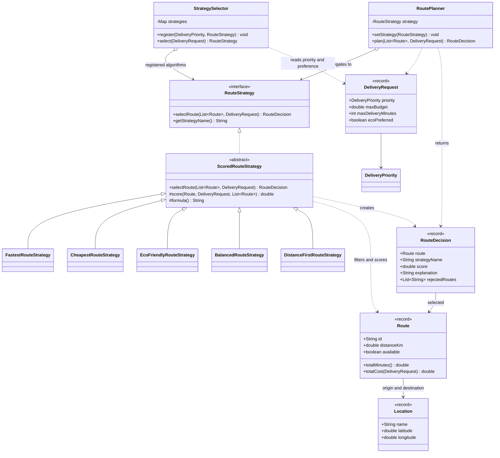
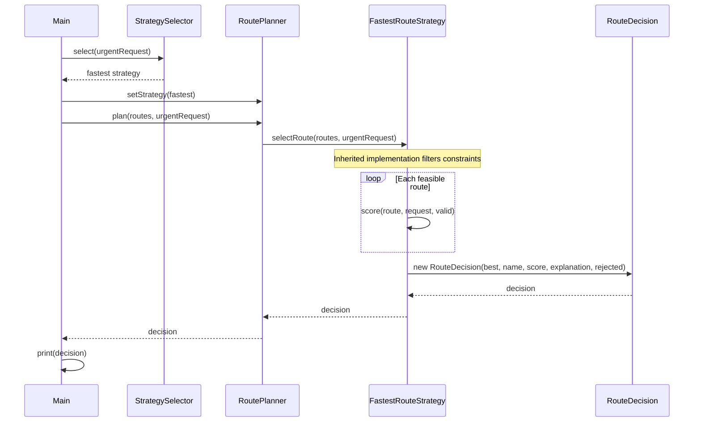

# Smart Delivery and Route Optimization Engine

Assignment 5 demonstrates the Strategy pattern in a small Java console application.
The program selects one of eight candidate routes according to time, cost,
environmental impact, a weighted balance, or distance. No external service is needed.

## Run and test

Requirements: JDK 17 or newer and Maven 3.6.3 or newer. JUnit 5 is the only dependency
and is used only for tests. Maven downloads it on the first test run.

```sh
mvn test
java -cp target/classes org.example.Main
```

In IntelliJ IDEA, open `pom.xml` as a Maven project, select JDK 17 or newer,
and run `Main` or `RoutePlannerTest`. IntelliJ also includes Maven.

To run without Maven on Windows, use the included PowerShell script:

```powershell
powershell -ExecutionPolicy Bypass -File .\run.ps1
```

On this computer, Maven is bundled with IntelliJ and can be called directly:

```powershell
& 'C:\Program Files\JetBrains\IntelliJ IDEA Community Edition 2024.2.1\plugins\maven\lib\maven3\bin\mvn.cmd' test
```

## Architecture and the Strategy pattern

The problem is that route selection changes with the delivery's business goals.
A single planner with a growing chain of algorithm-specific conditions would mix
unrelated scoring rules and make each new algorithm require changes to the planner.

`RoutePlanner` is the Context. It stores a `RouteStrategy`, allows replacing it through
`setStrategy`, and delegates `plan` to it. It contains no scoring algorithm and never
checks concrete strategy types or names.

`RouteStrategy` is the Strategy interface. Its methods are `selectRoute` and
`getStrategyName`. The concrete strategies are `FastestRouteStrategy`,
`CheapestRouteStrategy`, `EcoFriendlyRouteStrategy`, `BalancedRouteStrategy`, and
`DistanceFirstRouteStrategy`.

`ScoredRouteStrategy` shares the constraint filtering, score comparison and explanation
code. Each concrete class supplies a formula and a scoring method. This avoids five
copies of the same validation loop. Equal scores keep the first route in input order.

`StrategySelector` has a separate responsibility: choosing which algorithm to use.
Its enum-to-strategy map can be changed with `register`; it does not calculate scores.
The default rules are URGENT -> fastest, ECONOMY -> cheapest, ECO -> eco-friendly,
and STANDARD -> balanced. `ecoPreferred` selects eco-friendly for nonurgent requests;
urgency takes precedence over that preference.

The interface returns a `RouteDecision` instead of only a `Route`. This small extension
keeps the selected route, strategy name, score, explanation and rejected-route reasons
together. Rejection messages are an immutable list. `Main` formats the output.

This is Strategy because the planner delegates a replaceable algorithm through an
interface. The small preference condition in the selector expresses business policy;
it does not implement alternative route algorithms.

## Domain and demonstration data

`Location` contains a name and geographic coordinates. `Route` contains origin,
destination, distance, estimated minutes, base cost, emissions, traffic delay and
availability. `DeliveryRequest` contains priority, maximum budget, deadline and eco
preference. Records keep these objects immutable and validate their inputs.

All demo routes share the Almaty depot and customer endpoints. Money is in KZT,
distance in km, time in minutes, and estimated emissions in kg CO2.

| Route | Distance | Base time | Traffic delay | Base cost | CO2 | Available |
| --- | ---: | ---: | ---: | ---: | ---: | --- |
| A | 12 | 18 | 15 | 3500 | 4.5 | yes |
| B | 15 | 22 | 2 | 4000 | 5.0 | yes |
| C | 10 | 45 | 0 | 2000 | 0.5 | yes |
| D | 18 | 40 | 5 | 500 | 3.0 | yes |
| E | 8 | 35 | 3 | 2200 | 1.0 | yes |
| F | 20 | 28 | 4 | 2500 | 6.0 | yes |
| G | 6 | 12 | 0 | 100 | 0.1 | no |
| H | 14 | 55 | 10 | 800 | 2.0 | yes |

## Constraints and formulas

Every strategy first rejects unavailable routes, routes whose total cost exceeds
the request budget, and routes whose total time exceeds the deadline. Equality with
the budget or deadline is allowed. Rejected candidates never influence scores or
balanced normalization.

```text
totalTime = estimatedMinutes + trafficPenaltyMinutes
prioritySurcharge = 500 for URGENT, otherwise 0
totalCost = baseCost + distanceKm * 100 + prioritySurcharge
```

`Route` owns these two shared calculations so scoring and hard constraints use the
same definitions. The urgent surcharge is constant per request, so it changes
eligibility but does not reorder the costs of otherwise feasible routes.

Each strategy minimizes its score:

| Strategy | Score |
| --- | --- |
| Fastest | totalTime |
| Cheapest | totalCost |
| Eco Friendly | carbonEmission * 0.8 + distanceKm * 0.2 |
| Balanced | normalizedTime * timeWeight + normalizedCost * costWeight + normalizedDistance * distanceWeight + normalizedEmission * emissionWeight |
| Distance First | distanceKm |

Fastest includes traffic: A has a shorter base time than B, but B's final time is
24 minutes compared with A's 33. Eco scoring belongs inside the eco strategy because
the environmental tradeoff is an algorithm policy, unrelated to the planner or
strategy selection. Its coefficients are illustrative scoring factors with chosen
units, rather than a physical formula for emissions.

Balanced normalizes each metric as `value / maximum feasible value`. If a metric's
maximum is zero, its normalized value is zero. Default weights are 0.40 time,
0.30 cost, 0.10 distance, and 0.20 emissions. Weights must be finite, nonnegative,
and sum to 1 within a floating point tolerance of 0.000001. Invalid values throw
`IllegalArgumentException`.

## Runtime switching and dynamic requests

The first loop in `Main` is the comparison mode. It runs all five strategies against
the same request and candidate list using one `RoutePlanner`. Moving through the
five strategies demonstrates four runtime switches. Each result includes the
score, total time, total cost, distance, emissions and rejection reasons.

The next loop shows automatic selection for different requests. For example, an
urgent delivery with budget 10000 and deadline 30 chooses B. Another urgent delivery
with budget 5500 and deadline 40 chooses F because B costs 6000 with the urgent
surcharge. The same algorithm can therefore choose different routes.

## Failure handling

The demo explicitly catches and prints three failures: an empty route list, an
impossible budget/deadline combination, and invalid balanced weights.

Empty lists and requests with no feasible candidate throw `NoSuitableRouteException`.
The latter includes rejection reasons. Invalid domain values, such as negative
distance or cost, missing priority, nonfinite numeric input, or invalid coordinates,
throw `IllegalArgumentException`. Missing strategy, route list or request throws
`NullPointerException` with a descriptive message. These failures never return null.

## UML class diagram



## UML sequence diagram

`selectRoute` is inherited from `ScoredRouteStrategy`; dynamic dispatch invokes
`FastestRouteStrategy.score` for each feasible candidate.



## Adding another strategy and SOLID

Add a class extending `ScoredRouteStrategy` and implement `score`, `formula`, and
`getStrategyName`. Alternatively implement `RouteStrategy` directly if the algorithm
needs a different approach. Add an instance to the comparison list in `Main`, or
register it in `StrategySelector` for an existing priority when automatic selection
is desired.

The fifth algorithm was introduced in the separate commit
`Extend working application with distance-first strategy` after the initial console
application was working. Only one existing class, `Main`, changed to include it in
comparison. Neither `RoutePlanner` nor the four existing algorithms changed.

- SRP: the planner delegates, the selector chooses an algorithm, strategies score,
  shared code filters and explains, and `Main` prints results.
- OCP: the distance-first algorithm extends the implementation without changing
  the Context or other algorithms. Composition in `Main` still needs an entry.
- DIP: `RoutePlanner` holds the `RouteStrategy` abstraction, not a concrete algorithm.

Strategy and Bridge both use composition. Strategy replaces an algorithm for one
task, such as route selection. Bridge separates two independently changing
dimensions, such as a delivery service abstraction and transport implementations.
This project has interchangeable selection algorithms, rather than two such
independent hierarchies. This is a conceptual comparison; the previous assignment's
source is not part of this repository.

Limitations: the application ranks supplied routes instead of computing paths on a
road graph. Traffic and emissions are fixed estimates. Balanced normalization depends
on the feasible candidate set and can be influenced by outliers; repeated scans make
balanced comparison quadratic. Money uses double for this small assignment, whereas
a financial application should use integer minor units or BigDecimal. Adding a new
priority also requires an enum entry and selector registration.

## Example console output and test results

Selected lines from the real run (full output: [docs/demo-output.txt](docs/demo-output.txt)):

```text
COMPARISON AND RUNTIME SWITCHING (same request and planner)
Fastest -> B
Cheapest -> H
Eco Friendly -> C
Balanced -> E
Distance First -> E
```

For the standard comparison request, results are:

| Strategy | Route | Time | Total cost | Distance | CO2 | Score |
| --- | --- | ---: | ---: | ---: | ---: | ---: |
| Fastest | B | 24 | 5500 | 15 | 5.0 | 24 |
| Cheapest | H | 65 | 2200 | 14 | 2.0 | 2200 |
| Eco Friendly | C | 45 | 3000 | 10 | 0.5 | 2.4 |
| Balanced | E | 38 | 3000 | 8 | 1.0 | 0.4708 |
| Distance First | E | 38 | 3000 | 8 | 1.0 | 8 |

An example explanation is:

```text
score = estimated minutes + traffic penalty; minimum score 24.0000.
Time: 22 + 2 traffic = 24 min
Rejected G: route unavailable
```

Verified with JDK 21 compiling for Java 17 and Maven 3.9.8:

```text
Tests run: 27, Failures: 0, Errors: 0, Skipped: 0
BUILD SUCCESS
```

The [JUnit suite](src/test/java/org/example/RoutePlannerTest.java) covers all five
strategies, weighted normalization, configurable weights, runtime switching,
automatic selection and registration, eco preference, urgent surcharge, availability,
budget and deadline restrictions in every strategy, no valid route, an empty list,
missing data, invalid domain values, comparison, dynamic requests, deterministic ties,
exact budget/deadline boundaries and zero-value normalization.
The actual Surefire summary is saved in [docs/test-results.txt](docs/test-results.txt).

## Submission

Submit the public repository link and this README as the report in Moodle.
The class and sequence diagrams above render directly on GitHub. To inspect the
development steps, use `git log --reverse --format=fuller`.
